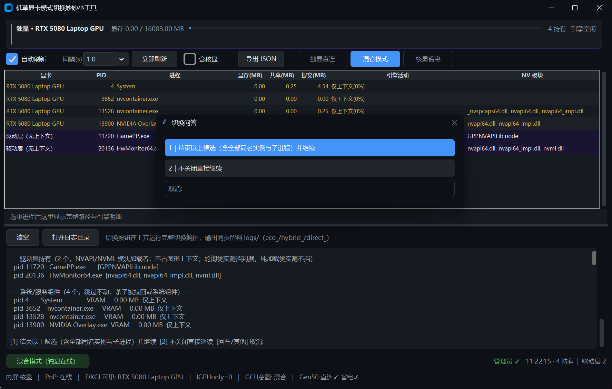

# 机革显卡模式切换妙妙小工具

机械革命控制中心切显卡模式经常失败，弹一句「有程序正在使用独立显卡」，但不说是谁在用，只能自己一个个猜。这个小工具把两件事一起做了：查出谁在占用独显，然后帮你把模式真切过去。

## 功能

查占用。列出当前占用独显的所有进程，进程名、PID、显存占用都有，表格自动刷新，新出现的进程黄底高亮，右键可以结束进程、复制 PID、打开文件位置。任务管理器看不到的占用（比如 HWiNFO 这类不创建图形上下文的监控软件）也能抓到。

切模式。界面上三个按钮：独显直连、混合模式、核显省电。切换前先把占用独显的软件关掉，提权进程也杀得动；然后发跟控制中心相同的切换命令，切完验证是否真的生效。过程有日志，失败在哪一步能看出来。

## 截图

主界面。谁在占用独显一目了然：显存、共享、提交各占多少，加载了哪些 NV 模块都列在表里，底部一排徽章是当前显示模式的凭证。


切换过程中的两处问答。占用没清干净时先问要不要结束候选，不想动它也可以直接继续或取消；要重启的切换则给你三选，取消会撤回指令恢复原样，不留不上不下的状态。

| 结束占用候选 | 重启三选 |
|---|---|
|  |  |

核显省电切换成功：右边是机械革命控制中心，工具这边报 EC 级断开、独显已从总线消失，控制中心那边省电也显示开启，两边口径一致。


## 适用机型

查占用不限机型。切换只支持走 GCU 的机械革命机型，即同方模具的 30/40/50 系。蛟龙 30 系部分、WUJIE14XA、星耀、UMI/NUC 是宝龙达 Uniwill 模具，不走 GCU 协议，工具会直接报不支持，不会发命令。

> 重点：只在机械革命同方模具 50 系上实测过，理论上只要是走机械革命控制台的机型都能用。

| 代际 | 核显省电 | 直连 ⇄ 混合 | 说明 |
|---|---|---|---|
| 30 系 | ✗ | ✓ | 档位能力按机器自动判定，不支持的直接拒绝 |
| 40 系 | 三模档 ✓ / 双模档 ✗ | ✓ | 同上 |
| 50 系 | ✓ | ✓ | 实测最充分的机型 |

## 用法

下载 `gpu_mode_switcher.exe`（约 12 MB），双击，UAC 确认一次。杀进程和切换都需要管理员权限。

三个模式的区别：

- 核显省电：独显整卡断电，续航最长。混合模式下直接切，不用重启；直连模式下点它会先退出直连，同样问你要不要重启，重启一次直达省电。之后控制中心里显示也正常（混合模式选中、省电开启），想回混合随时可切，不用再重启。
- 混合模式：出厂默认状态，按需唤醒独显。
- 独显直连：内屏直连独显，性能最好也最费电。进出直连都要重启才生效，工具会问你是立即重启、稍后自己重启还是取消。取消会撤回命令、恢复原样。

界面底部一排徽章显示当前显示模式的凭证（内屏路由、设备状态等），想确认切换是否到位看这里。

## 注意

- 切换前保存手头的工作，游戏、渲染这类占用独显的程序工具会提示先关。
- 从独显直连切核显省电后，重启登录时系统可能请求一次权限确认——那是自动登记当前模式的命令，确认即可，不确认也不影响切换本身。
- 在核显省电模式下重启电脑，开机后独显会短暂上线几十秒再自动断电回到省电，这是正常过程；期间若有软件抢先占用独显导致省电没回来，登录后等一分钟再跑一次 `--eco reconcile` 即可。
- 每次切换的日志都在软件旁边的 logs 目录，反馈问题直接带上。

## 独显关不掉的常见原因

硬件监控软件（HWiNFO、HWMonitor、GamePP、AIDA64）轮询显卡传感器会让独显常驻；浏览器和各种客户端的 GPU 加速也算。名单清干净了还关不掉，多半是显示器直连独显（混合屏、高刷屏常见），这就不是软件能解决的了。

## 命令行

不想开界面可以用命令行，纯 Python 标准库，不用装任何包：

```powershell
python dgpu_detective.py                # 抓当前独显持有进程清单
python dgpu_detective.py --watch        # 持续监视，新持有进程冒头即报
python dgpu_detective.py --status       # 当前显示模式与凭证
python dgpu_detective.py --gcu-info     # 机型探测结果（代际/能力/切换通道）
python dgpu_detective.py --eco          # 核显省电一键切换（检测→清场→切换→验证）
python dgpu_detective.py --eco off      # 省电态切回混合
python dgpu_detective.py --direct       # 独显直连（重启三选）
python dgpu_detective.py --direct off   # 直连回混合
python dgpu_detective.py --hybrid       # 回混合模式（按当前态自动挑路）
python dgpu_detective.py --eco reconcile  # 省电对账（重启后省电没回来时跑它；平时自动执行）
```

## 源码运行与打包

```powershell
python -m pip install -i https://pypi.tuna.tsinghua.edu.cn/simple customtkinter
python dgpu_gui.py                          # 源码运行界面
pwsh -NoProfile -File build_exe.ps1         # 打包出 dist\gpu_mode_switcher.exe
```

占用检测的计数器方案来自 [shanselman/gputaskman](https://github.com/shanselman/gputaskman)（MIT）。检测原理、判据设计、切换编排见 [docs/技术细节.md](docs/技术细节.md)。
