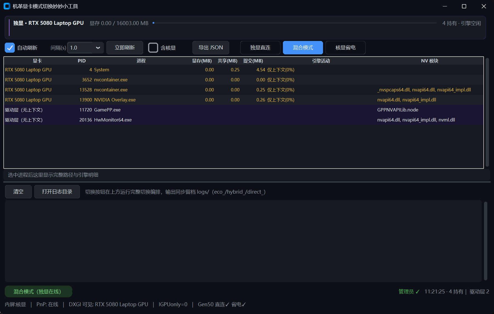
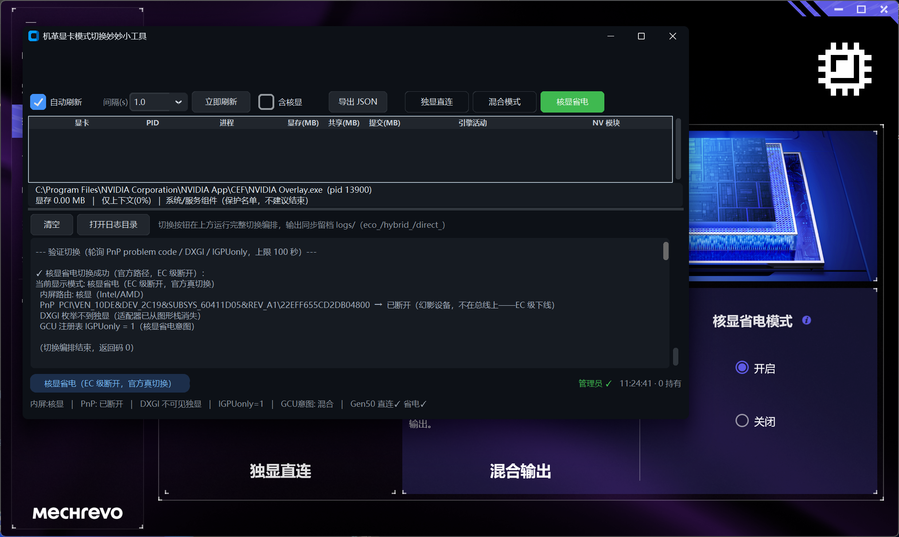
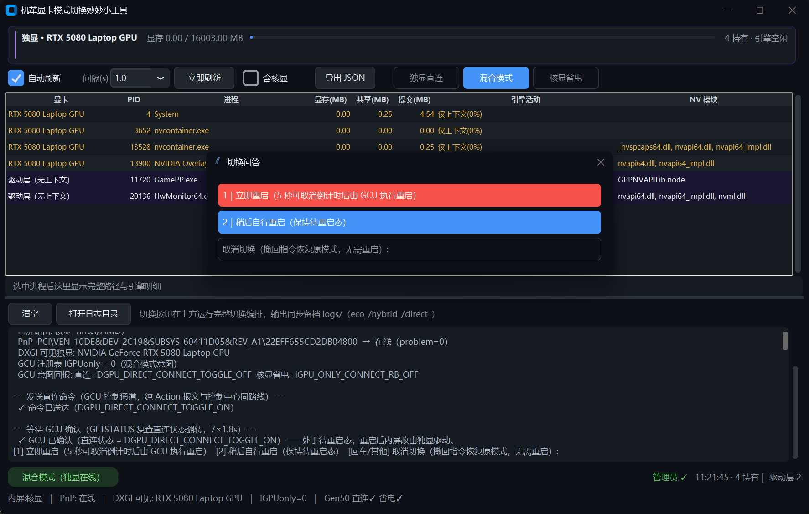
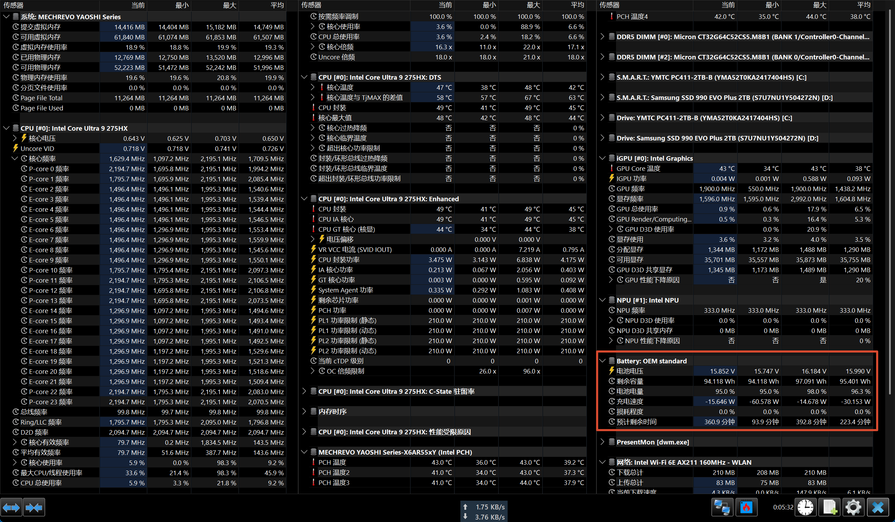

# 机革显卡模式切换妙妙小工具

机械革命控制中心切显卡模式经常失败，弹一句「有程序正在使用独立显卡」，但不说是谁在用，只能自己一个个猜。这个小工具把两件事一起做了：查出谁在占用独显，然后帮你把模式真切过去。

## 功能

占用检测做成一张自动刷新的表。谁在占独显、显存占多少都能看到，新出现的进程黄底高亮；右键可以结束进程、复制 PID、打开文件位置。HWiNFO 这类不创建图形上下文的监控软件在任务管理器里看不见，这里抓得到。

切换就是那三个按钮：独显直连、混合模式、核显省电。点下去先清场，把占用独显的软件关掉（提权进程也杀得动），再发跟控制中心相同的切换命令，切完还验证一遍是不是真的生效了。每一步都有日志，失败卡在哪一步看得出来。

## 截图

主界面长这样。下面两行紫底的「驱动层」是 WDDM 抓不到、靠模块扫描补出来的持有者（GamePP、HWMonitor 这类）；底部一排徽章是当前显示模式的凭证。旁边那张是切到核显省电之后的样子：工具报 EC 级断开、独显已从总线消失，右边开着的机械革命控制中心里省电同样显示开启，两边可以对一下。

| 主界面 | 核显省电切换成功 |
|---|---|
|  |  |

切换时有两处会问你话。占用没清干净，先问要不要结束候选，不想动可以不关直接继续，或者取消；要重启的切换给三选，取消会撤回指令恢复原样，不会停在不上不下的状态。

| 结束占用候选 | 重启三选 |
|---|---|
|  |  |

真核显模式下效果：控制台开办公模式，Windows 里开省电模式，屏幕 60Hz，HWiNFO 读到电池放电速度 平均 30 W，预计剩余时间 220 分钟。



## 适用机型

查占用不限机型。切换只支持走 GCU 的机械革命机型，即同方模具的 30/40/50 系。蛟龙 30 系部分、WJIE14XA、星耀、UMI/NUC 是宝龙达 Uniwill 模具，不走 GCU 协议，工具会直接报不支持，不会发命令。

这代有没有「核显省电」档位是硬件决定的，不是软件版本问题。

30 系和 40 系常规机型的官方省电是另一种做法，工具叫它运行时省电（lite）：断开独显的显示输出、把屏幕降刷新率、把独显设备在系统里软禁用，独显本身还在主板上是活的，只是不干活；想回混合再启用一遍就行，跟三模机型上一键来回的「独显整卡断电」不是一个体验，但这是官方给这类机型准备的全部。现在这类机器点核显省电，工具会自动改走这条官方同款路线，界面和命令行都会写明当前走的是哪种。

40 系双显三模机型和 50 系才有独显整卡断电的省电档，官方给这两类机型发的控制台安装包都单独拆了线。

| 代际 | 核显省电 | 直连 ⇄ 混合 | 说明 |
|---|---|---|---|
| 30 系 | lite ✓ | ✓ | 官方同款运行时省电（断输出+降刷新率+设备软禁用），非整卡断电 |
| 40 系双显三模机型 | ✓ | ✓ | 官方单独发三模安装包，切换命令与 50 系完全一致；待真机反馈 |
| 40 系常规机型 | lite ✓ | ✓ | 官方省电与 30 系同款（运行时省电），独显不整卡断电 |
| 50 系 | ✓ | ✓ | 实测最充分的机型 |

分不清自己的 40 系是哪种档位，跑一下 `python dgpu_detective.py --gcu-info`，机器支持哪几个档位会直接报出来；界面版右下角的能力角标是同一个探测结果。

> 重点：切换功能只在 50 系上真机实测过。40 系双显三模机型的协议与官方安装包逐一核对一致（同一个服务端、同一套切换命令），差的是真机反馈；30 系和 40 系常规机型没有整卡断电档不是适配问题，硬件本身没有这个档位，它们的运行时省电走的也是官方同款命令，同样待真机反馈。

## 用法

下载 `gpu_mode_switcher.exe`（约 12 MB），双击，UAC 确认一次。杀进程和切换都需要管理员权限。

三个模式的区别：

- 核显省电：独显整卡断电，续航最长。混合模式下直接切，不用重启；直连模式下点它会先退出直连，同样问你要不要重启，重启一次直达省电。之后控制中心里显示也正常（混合模式选中、省电开启），想回混合随时可切，不用再重启。30 系和 40 系常规机型没有整卡断电的档位，点这个按钮会自动改走官方运行时省电（断输出+降刷新率+设备软禁用，非整卡断电）。
- 混合模式：出厂默认状态，按需唤醒独显。
- 独显直连：内屏直连独显，性能最好也最费电。进出直连都要重启才生效，工具会问你是立即重启、稍后自己重启还是取消。取消会撤回命令、恢复原样。

界面底部一排徽章显示当前显示模式的凭证（内屏路由、设备状态等），想确认切换是否到位看这里。

## 注意

- 切换前保存手头的工作，游戏、渲染这类占用独显的程序工具会提示先关。
- 从独显直连切核显省电后，重启登录时系统可能请求一次权限确认，那是自动登记当前模式的命令，确认即可，不确认也不影响切换本身。
- 在核显省电模式下重启电脑，开机后独显会短暂上线几十秒再自动断电回到省电，这是正常过程；期间若有软件抢先占用独显导致省电没回来，登录后等一分钟再跑一次 `--eco reconcile` 即可。
- 每次切换的日志都在软件旁边的 logs 目录，反馈问题直接带上。

## 独显关不掉的常见原因

硬件监控软件（HWiNFO、HWMonitor、GamePP、AIDA64）轮询显卡传感器会让独显常驻；浏览器和各种客户端的 GPU 加速也算。名单清干净了还关不掉，多半是显示器直连独显（混合屏、高刷屏常见），这就不是软件能解决的了。

## 命令行

不想开界面可以用命令行，纯 Python 标准库，不用装任何包：

```powershell
python dgpu_detective.py                # 抓当前独显持有进程清单
python dgpu_detective.py --watch        # 持续监视，新持有进程冒头即报
python dgpu_detective.py --status       # 当前显示模式与凭证
python dgpu_detective.py --gcu-info     # 机型探测结果（代际/能力/切换通道）
python dgpu_detective.py --eco          # 核显省电一键切换（检测→清场→切换→验证；30/40 常规机型自动改走运行时省电）
python dgpu_detective.py --eco off      # 省电态切回混合
python dgpu_detective.py --eco lite     # 运行时省电开关（显式入口，30/40 常规机型）
python dgpu_detective.py --eco lite off # 关闭运行时省电，恢复混合
python dgpu_detective.py --direct       # 独显直连（重启三选）
python dgpu_detective.py --direct off   # 直连回混合
python dgpu_detective.py --hybrid       # 回混合模式（按当前态自动挑路）
python dgpu_detective.py --eco reconcile  # 省电对账（重启后省电没回来时跑它；平时自动执行）
```

## 源码运行与打包

```powershell
python -m pip install -i https://pypi.tuna.tsinghua.edu.cn/simple customtkinter
python dgpu_gui.py                          # 源码运行界面
pwsh -NoProfile -File build_exe.ps1         # 打包出 dist\gpu_mode_switcher.exe
```

占用检测的计数器方案来自 [shanselman/gputaskman](https://github.com/shanselman/gputaskman)（MIT）。检测原理、判据设计、切换编排见 [docs/技术细节.md](docs/技术细节.md)。
