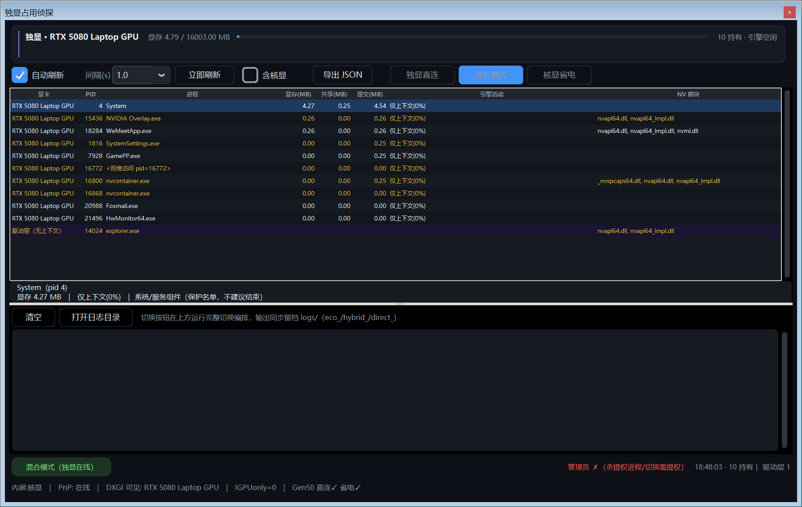

# dgpu_detective — 独显占用侦探

识别**到底是哪个进程在占用独立显卡**，导致独显无法休眠/关闭；
并支持机械革命 GCU 机型的显示模式三态切换（核显省电 ⇄ 混合 ⇄ 独显直连）。

灵感与计数器方案借鉴自 [shanselman/gputaskman](https://github.com/shanselman/gputaskman)
（参考仓库快照在 `reference/gputaskman-src/`，核心是它的 `pdh.py` + `dxgi.py`）。

## 适用范围（显示模式切换功能）

占用检测/驱动层口径全机型可用；**显示模式切换（--eco / --direct）只支持走 GCU 的
机械革命机型**（同方 AiStone 模具：30/40/50 系、WJXY 无界系）。宝龙达 Uniwill 模具
（蛟龙 30 系部分、WUJIE14XA、星耀、UMI/NUC）不在范围。

各代际能力（发令前按词表硬门禁，词表外命令一律不发）：

| 代际 | 核显省电 | 直连⇄混合 | 说明 |
|---|---|---|---|
| 30 系 | ✗ | ✓（TOGGLE_ON/OFF） | 无重启命令；词表外动作自动拒绝 |
| 40 系 | 三模档 ✓ / 双模档 ✗ | ✓ | 档位按能力位自动判定；三模待真机反馈 |
| 50 系 | ✓ | ✓ | 本机实测机型；热切换词表在但 GCU 侧 no-op，不提供 |

`--gcu-info` 可随时查看本机探测结果（代际/词表/能力位/GCU 意图回报）。
30/40 系行为由能力探测 + 代际词表设计保证「最坏情况如实报不支持」，待真机反馈。

## 用法

```powershell
python dgpu_detective.py                # 抓当前独显持有进程清单
python dgpu_detective.py --list-gpus    # 列出所有显卡适配器（含独显判定）
python dgpu_detective.py --all          # 核显等非独显适配器也一并报告
python dgpu_detective.py --watch        # 持续监视独显，新持有进程冒头即时报告
python dgpu_detective.py --watch --interval 2
python dgpu_detective.py --json         # 一次性 JSON 快照
python dgpu_detective.py --status       # 当前显示模式与凭证（内屏路由/PnP/DXGI/GCU 意图）
python dgpu_detective.py --gcu-info     # GCU 探测结果（代际/词表/能力位/意图回报）
python dgpu_detective.py --eco          # 核显省电一键切换（检测→清场→发官方同款命令→验证，全自动）
python dgpu_detective.py --eco off      # 切回混合模式（发官方同款命令→验证）
python dgpu_detective.py --direct       # 独显直连（发令→GCU确认→重启三选；MUX 切换重启生效）
python dgpu_detective.py --direct off   # 直连回混合（同构编排）
python dgpu_detective.py --hybrid       # 回混合模式（目标态入口，按当前态自动路由上面两条回混合路）
```

仅 Python 标准库（ctypes 调 `pdh.dll` + `dxgi.dll` 等），无需管理员权限
（`--eco` 清场与 `--direct` 重启确认按需提权/确认）。

## 图形界面（GUI / exe）

CustomTkinter 深色界面，统一设计系统：Microsoft YaHei UI 全局字体、GitHub Dark
系单色板、当前显示模式按钮实色点亮（态式切换按钮）、保护名单警示黄（红色只留给
危险/故障）。源码运行需装界面层依赖（CLI 引擎仍是纯标准库）：

```powershell
python -m pip install -i https://pypi.tuna.tsinghua.edu.cn/simple customtkinter
python dgpu_gui.py
```

构建单文件 exe（约 12 MB，依赖自动打包，缺装会自检）：

```powershell
pwsh -NoProfile -File build_exe.ps1    # 产出 dist/dgpu_detective.exe（onefile + uac-admin）
```



- **exe 双击即请求管理员**（uac-admin 清单）——杀提权占用软件、切换省电都需要；
  切换编排原样复用命令行 `--eco` / `--direct` 代码，只是跑在内嵌控制台里
- 持有者表格 = `--report`/`--watch` 常驻版：自动刷新（间隔可调）、新持有黄底高亮、
  右键菜单（结束进程树 / 结束全部同名 / 复制 PID / 打开文件位置），保护名单警示黄不杀；
  显卡列表每轮随采样重新枚举——切换显示模式后适配器消失/重现（LUID 变化）不失配，
  顶部横条面板同步撤掉已消失的适配器（显存占用条实时更新）
- 底部徽章 = `--status` 四态凭证实时显示（内屏路由 / PnP problem / DXGI / GCU 意图），
  附能力角标（代际 + 直连/省电能力位，启动时后台探测一次）
- 「独显直连 / 混合模式 / 核显省电」按钮 = 内嵌控制台运行完整切换编排，
  按当前态与能力自动启用/禁用；「混合模式」为目标态入口（省电态走 MQTT 回线、
  直连态走 MUX 重启三选，自动挑路）；问答弹框应答（重启三选默认安全侧「稍后自行重启」），
  输出同步留档 `logs/eco_*.txt`、`logs/hybrid_*.txt`、`logs/direct_*.txt`；
  「导出 JSON」= `--json` 同构快照
- 驱动层持有者（NVAPI/NVML 模块口径，补 WDDM 盲区）**合并进主表格**：后台线程
  每 3s 自动扫，不手动刷新——WDDM 表里已有的进程在其行「NV 模块」列标注；
  WDDM 抓不到的（HWiNFO 等无图形上下文的传感器轮询软件）追加紫底行
  「驱动层（无上下文）」，右键菜单照常可用

## 原理

数据来自 **WDDM 图形内核的性能计数器**——任务管理器「性能 → GPU」背后同一套数据，
D3D / Vulkan / OpenGL / CUDA 全都过这一层（GeForce WDDM 模式下 nvidia-smi 每进程
显存常报 N/A，这套计数器反而全都有）。

三层链路：

1. **DXGI 枚举**（`CreateDXGIFactory1 → EnumAdapters1`）拿到每块卡的 LUID、厂商、
   独立显存 → 识别哪块是独显（NVIDIA 即独显；其余按独立显存 ≥512MB 判）。
2. **PDH 计数器**（`PdhAddEnglishCounterW`，中文系统不受计数器名本地化影响）：
   - `\GPU Process Memory(*)\Local Usage` — 进程驻留 VRAM 字节（用 Local 而非
     Dedicated：后者把共享 surface 重复记账，dwm.exe 能虚读到 15GB+）
   - `\GPU Process Memory(*)\Non Local Usage` — 溅到系统 RAM 的字节
   - `\GPU Process Memory(*)\Total Committed` — 提交总量
   - `\GPU Engine(*)\Utilization Percentage` — 每进程每引擎利用率
3. **实例名自带映射**：`pid_1234_luid_0x..._phys_0_eng_0_engtype_3D`，
   过滤 LUID=独显 → 直接得到独显上的全部持有进程。

关键点：**进程只要在独显上创建了 GPU 上下文，即使利用率 0%、显存 0，
引擎计数器实例也会出现**——这正是抓「导致独显关不掉的隐藏持有者」的依据。

## 输出解读

- 「仅上下文(0%)」= 进程挂着 GPU 上下文但没在干活——独显关不掉往往是这类
- 引擎利用率是 rate 计数器，一次性模式自动垫 0.5s 采样间隔
- `<拒绝访问 pid=N>` = 受保护进程（驱动/反作弊等），普通权限查不到名字
- pid 4 = System 内核进程

## 显示模式状态与切换

### 四态判据（--status）

三套独立凭证正交组合：

**凭证 A：内屏路由探测**（QueryDisplayConfig + GET_ADAPTER_NAME）——枚举显示路径，
过滤内屏 target（INTERNAL/LVDS/eDP/UDI 内接形态），看它挂在哪块适配器上：
含 `VEN_10DE` = 独显直连态；`VEN_8086`/`VEN_1002` = 核显。**直连态的本机权威判据**。

**PnP problem code**（cfgmgr32 双姿势定位）——2026-11-11 实测定案：官方「核显省电」
成功 = **EC 级断开**，独显设备从 PCI 总线消失（devnode 成幻影、DXGI 枚举不到）：

| PnP 状态 | 含义 | 判定（内屏挂核显时） |
|---|---|---|
| 在线（problem=0） | 设备在场正常工作 | 混合模式 |
| 软禁用（problem=22） | PnP 软件禁用，设备仍焊在总线上 | 假切换残留 |
| 已断开（幻影） | NORMAL 定位失败、PHANTOM 定位成功 | 核显省电（真切换） |

**凭证 B：GCU 意图回报**（MQTT GETSTATUS）——与凭证 A 实况不一致时记
**直连待重启态（direct_pending）**：直连命令发出后、重启前只有 GCU 知道有
pending 切换（官方控制中心的橙色高亮即此态）。

辅证：DXGI 独显可见性 + GCU 注册表 `IGPUonly`（三根回退：GamingCenter2 →
GamingCenter → ControlCenter，切换成功时由 GCU 亲手更新）。

### GCU 探测（--gcu-info）

诊断入口，一次打印：机器身份（IsMechrevo 判定）、dGPU 代际（显卡名 RTX 正则 →
PCI DeviceId 高字节两级判定）、本机代际词表（发令硬门禁）、能力位（核显省电 /
独显直连，在线回报优先、注册表三根双视图回落）、GCU 通道状态与意图回报原文。
MQTT 凭据走三槽回退链（_4 → _3 → _2）：官方控制中心/L-Mechrevo 占用首选槽时
自动落下一槽，三槽全被拒才报通道不可用。

### 核显省电切换（--eco）

把「找出占用 → 清场 → 切换 → 验证」串成一条全自动命令。**切换走机械革命控制
中心自己的通道**（2026-11-11 挖明架构：控制中心 UI → GCUBridge（127.0.0.1:13688，
MQTT broker）→ GCUService 执行全套官方逻辑）。本工具内置纯标准库 MQTT 客户端，
向 `Setting/Control` 发布与控制中心点击完全相同的命令（`IGPU_ONLY_CONNECT_RB_ON`），
GCUService 收令后的判据检查、NV 服务联动、EC 写入、超时回滚与人工点击一字不差；
不再走 PnP 软禁用（那是假切换），也无需再到控制中心手动点击：

1. **前置状态检测**：已在省电态 → 直接退出；检测到 PnP 软禁用残留 → 提示先恢复
2. **检测（双口径）**：
   - **图形上下文**（WDDM 计数器）：抓独显全部持有进程（比 nvidia-smi 全，含 0
     显存纯上下文持有者），自动过滤已退出的陈旧计数器实例
   - **驱动层**（NVAPI/NVML 模块加载者）：传感器轮询类软件（HWiNFO 等）可能不
     创建图形上下文，WDDM 与 nvidia-smi 都看不见它们，但 GCU「显卡使用中」判据
     看得到（2026-11-11 实测：HWiNFO 开着切换被拒、关掉即成功）——扫描全系统
     进程加载的 nvapi/nvml/nvspcaps 模块补上这个盲区
3. **分类提示**：用户软件列为候选；系统/服务组件（dwm / explorer / nvcontainer /
   GCU 后台等）只列出不动——杀了会被系统拉回或断控制通道，且实测不阻碍官方切换
4. **关闭**：确认后按进程名 `taskkill /F /T /IM` 强杀——**全部同名实例与各自的
   进程树一起结束**（覆盖同名子进程场景）；taskkill 结果如实显示
5. **复查（双口径）**：重新采样 + 模块重扫（+2s 等计数器实例消失）；同名新 pid /
   重新加载标「被守护/自启拉回」，其余残留如实报告
6. **发送切换命令**：MQTT 发布官方同款命令并接收 GCU 回报（判据码
   `CheckDGpuStatusforIGpuOnlyOnSuccess`：1 = GCU 判「显卡使用中」拒绝，
   2 = 判据通过切换执行），**判据码一到即返回不傻等**；判据码 1 则**等 10s
   自动重发，最多 3 次**——GCU 驱动层判据回落比进程退出/WDDM 计数器滞后
   （实测回落需 ~18s，清场后立刻首发多半被拒，静置抢跑没有意义，重试才是覆盖
   回落时间浮动的正解）；3 次均被拒则不再空等，直接进入失败诊断；通道不可用
   （GCUBridge / GCUService 未运行）则如实报错
7. **凭证验证**：轮询 PnP/DXGI/IGPUonly（**上限 100 秒**——实测能成都在 ~100 秒内
   成，更长等待纯属浪费），EC 级断开即成功；超时/被拒则如实报告当前状态、
   查询 GCU 判据码并双口径复查独显持有（定位是谁又扑上来挡了判据）

`--eco`（on 方向）开头即提权（UAC 一次）：HwMonitor/GamePP 等硬件监控多以管理员
运行，不提权 taskkill 直接被拒。清场环节有确认，随时可取消。

已知暂态（清场后的判据滞后已由编排内置「被拒等 10s 重发 ×3」覆盖；
下列场景自动重发也可能被拒，隔 1-2 分钟重跑即可，均实测）：
- `--eco off` 后 1 分钟内立刻 `--eco`——off 刚把 NV 服务拉起，紧随的 on 撞上
  服务自停的残留上下文（15:45 被拒、15:48 同环境即成功）
- 系统重启后 ~20 分钟内的首切可能被拒（NV 生态初始化期，清场干净也拒，
  16:10 被拒、16:14 补发即过、判据码翻 2）

极端情况兜底：EC 断开⇄恢复连环切换过多后，设备可能卡 problem=43（驱动启动后
失败，2026-11-11 实测，App 内点击恢复无效）——解法按序：`pnputil /restart-device
<实例ID>`（提权）→ 仍 DXGI 不可见则 `Start-Service nvlddmkm` + 再 restart-device →
最后重启机器（POST 全归零，一步到位）。

### 切回混合模式（--eco off）

当前在省电态时可用：MQTT 发送 `IGPU_ONLY_CONNECT_RB_OFF`（与控制中心点击同路线），
轮询验证独显重新在线（PnP 在线 + DXGI 重现，2026-11-11 实测 6 秒完成）。
不杀进程、不动 PnP，无需提权。

### 独显直连切换（--direct / --direct off）

MUX 切换，**重启后生效**（内屏改由独显直接驱动；官方「Yes 立即重启 / No 重启后
生效」同款语义）。纯 `{"Action": "DGPU_DIRECT_CONNECT_TOGGLE_ON/OFF"}` 报文，
与控制中心点击同路线；`--eco` 行为不变，仅头部插入能力/词表前置。

`--direct`（混合 → 直连）流程：

1. **能力/词表前置**：不支持直连或词表外命令 → 如实退出（30 系无机种不发空命令）
2. **四态检查**：已直连 → 无需切换；已在「直连待重启」→ 提示重启即成；
   **核显省电态 → 自动串联「恢复混合」等独显回线再继续**（一次命令完成）
3. **发令 + GCU 确认**：GETSTATUS 复查直连状态翻转 `TOGGLE_ON`（7×1.8s 上限）
4. **重启三选**：[1] 立即重启（5 秒可取消倒计时后发 `DGPU_DIRECT_CONNECT_RESTART`，
   GCU 自己执行 `shutdown /r /t 0`）；[2] 稍后自行重启（保持待重启态，
   `--status` 显示 direct_pending）；[回车] 取消重启安排（命令已发，如实说明
   仍处待重启态——重启前显示模式不变）

`--direct off`（直连 → 混合）同构；退出直连同样需要重启。
GUI 的重启三选走问答框，默认应答取安全侧（2=稍后自行重启）。

## 独显关不掉的排查思路

1. 跑一次本工具，看持有清单。常见元凶：
   - **硬件监控软件**（HWMonitor、GamePP、AIDA64 等）轮询 GPU 传感器会强制独显常驻
   - **NVIDIA Overlay / nvcontainer**（GeForce Experience/APP 的覆盖层与容器服务）
   - 浏览器/客户端软件的 GPU 加速渲染
2. 逐个退出清单里的可疑进程，观察独显能否歇机（可开 `--watch` 盯着）
3. 进程全清了独显仍不休眠 → 非进程因素：
   - 显示器直连独显（混合屏/高刷屏常把输出焊在独显上，核显带不动）
   - 驱动面板的电源管理设置（NVIDIA 控制面板「首选图形处理器」）
   - `nvidia-smi -q` 查看当前电源状态与持有原因

## 文件

| 文件 | 说明 |
|---|---|
| `dgpu_detective.py` | 命令行主脚本（单文件，纯标准库） |
| `dgpu_gui.py` | 图形界面（CustomTkinter 深色主题，复用命令行引擎，界面层依赖 customtkinter） |
| `reference/gputaskman-src/` | 参考仓库快照（上游 MIT 许可） |
