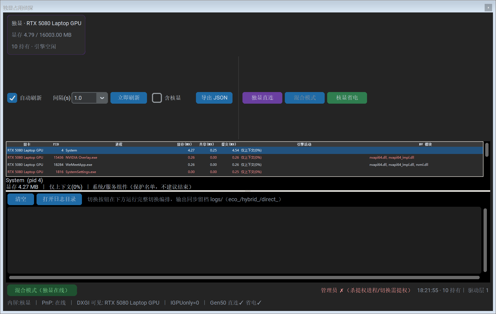

# 技术细节

面向用户的功能说明在根目录 README.md。这里是维护者视角的记录：检测原理、判据设计、切换编排，以及各次实测的数据和结论。

## 图形界面

CustomTkinter 深色界面，Microsoft YaHei UI 全局字体，GitHub Dark 系单色板。当前显示模式的按钮实色点亮；保护名单用警示黄，红色只留给危险和故障。源码运行需要装界面层依赖（CLI 引擎仍是纯标准库）：

```powershell
python -m pip install -i https://pypi.tuna.tsinghua.edu.cn/simple customtkinter
python dgpu_gui.py
```

打包单文件 exe（约 12 MB，依赖自动收集，缺了会自动装）：

```powershell
pwsh -NoProfile -File build_exe.ps1    # 产出 dist/gpu_mode_switcher.exe（onefile + uac-admin）
```



exe 带 uac-admin 清单，双击即请求管理员（杀提权占用软件、切换省电都需要）。切换编排原样复用命令行 `--eco` / `--direct` 的代码，只是跑在内嵌控制台里。

持有者表格相当于 `--report`/`--watch` 的常驻版：自动刷新（间隔可调），新持有进程黄底高亮，右键菜单可以结束进程树、结束全部同名、复制 PID、打开文件位置；保护名单里的进程标黄但不杀。显卡列表每轮随采样重新枚举，切换显示模式后适配器消失或重现（LUID 变化）不会失配，顶部横条面板同步撤掉已消失的适配器。

底部徽章是 `--status` 的四态凭证实时显示（内屏路由 / PnP problem / DXGI / GCU 意图），附带能力角标（代际 + 直连/省电能力位，启动时后台探测一次）。

三个模式按钮各自跑完整的切换编排，按当前态与能力自动启用或禁用。「混合模式」是目标态入口：省电态走 MQTT 回线，直连态走 MUX 重启三选，自动挑路。重启三选的问答弹框默认应答取安全侧（稍后自行重启）。切换输出留档在 `logs/eco_*.txt`、`logs/hybrid_*.txt`、`logs/direct_*.txt`。「导出 JSON」是 `--json` 的同构快照。

驱动层持有者（NVAPI/NVML 模块口径）合并进主表格，后台线程每 3 秒自动扫。WDDM 表里已有的进程在其行「NV 模块」列标注；WDDM 抓不到的（HWiNFO 这类无图形上下文的传感器轮询软件）追加紫底行「驱动层（无上下文）」，右键菜单照常可用。

## 原理

检测数据来自 WDDM 图形内核的性能计数器，任务管理器「性能 → GPU」页背后就是它。D3D / Vulkan / OpenGL / CUDA 全都过这一层。GeForce WDDM 模式下 nvidia-smi 的每进程显存经常报 N/A，这套计数器反而全都有。

三层链路：

1. DXGI 枚举（`CreateDXGIFactory1 → EnumAdapters1`）拿到每块卡的 LUID、厂商、独立显存。NVIDIA 即独显，其余按独立显存 ≥512MB 判。
2. PDH 计数器（`PdhAddEnglishCounterW`，中文系统不受计数器名本地化影响）：
   - `\GPU Process Memory(*)\Local Usage`：进程驻留 VRAM 字节。用 Local 而不是 Dedicated，后者把共享 surface 重复记账，dwm.exe 能虚读到 15GB+。
   - `\GPU Process Memory(*)\Non Local Usage`：溅到系统 RAM 的字节。
   - `\GPU Process Memory(*)\Total Committed`：提交总量。
   - `\GPU Engine(*)\Utilization Percentage`：每进程每引擎利用率。
3. 实例名自带映射：`pid_1234_luid_0x..._phys_0_eng_0_engtype_3D`，过滤 LUID=独显，直接得到独显上的全部持有进程。

进程只要在独显上创建了 GPU 上下文，哪怕利用率 0%、显存 0，引擎计数器实例也会出现。抓「独显关不掉的隐藏持有者」，靠的就是这个。

## 输出解读

- 「仅上下文(0%)」：进程挂着 GPU 上下文但没在干活，独显关不掉往往是这类。
- 引擎利用率是 rate 计数器，一次性模式自动垫 0.5s 采样间隔。
- `<拒绝访问 pid=N>`：受保护进程（驱动/反作弊等），普通权限查不到名字。
- pid 4 是 System 内核进程。

## 显示模式状态与切换

### 四态判据（--status）

状态由三套互不依赖的凭证组合判断。

凭证 A，内屏路由探测（QueryDisplayConfig + GET_ADAPTER_NAME）：枚举显示路径，过滤内屏 target（INTERNAL/LVDS/eDP/UDI 内接形态），看它挂在哪块适配器上。含 `VEN_10DE` 是独显直连态，`VEN_8086`/`VEN_1002` 是核显。这是直连态的本机权威判据。

PnP problem code（cfgmgr32 双姿势定位），2026-11-11 实测定案：官方「核显省电」成功等于 EC 级断开，独显设备从 PCI 总线消失（devnode 成幻影、DXGI 枚举不到）：

| PnP 状态 | 含义 | 判定（内屏挂核显时） |
|---|---|---|
| 在线（problem=0） | 设备在场正常工作 | 混合模式 |
| 软禁用（problem=22） | PnP 软件禁用，设备仍在总线上 | 假切换残留 |
| 已断开（幻影） | NORMAL 定位失败、PHANTOM 定位成功 | 核显省电（真切换） |

凭证 B，GCU 意图回报（MQTT GETSTATUS）：与凭证 A 实况不一致时记为直连待重启态（direct_pending）。直连命令发出后、重启前，只有 GCU 知道有 pending 切换，官方控制中心的橙色高亮就是这个态。

辅证：DXGI 独显可见性，加上 GCU 注册表 `IGPUonly`（三根回退：GamingCenter2 → GamingCenter → ControlCenter，切换成功时由 GCU 亲手更新）。

### GCU 探测（--gcu-info）

诊断入口，一次打印：机器身份（IsMechrevo 判定）、dGPU 代际（显卡名 RTX 正则、PCI DeviceId 高字节两级判定）、本机代际词表（发令硬门禁）、能力位（核显省电/独显直连：GCU 活跃回报某功能的状态字段即为支持实证，优先于开关位——2026-11-20 40 系三模真机实测开关位误报 0 而状态字段正常回报，曾致核显省电按钮被误禁；开关位之外走注册表三根双视图回落）、GCU 通道状态与意图回报原文。MQTT 凭据走三槽回退链（_4 → _3 → _2）：官方控制中心或 L-Mechrevo 占着首选槽时自动落下一槽，三槽全被拒才报通道不可用。

### 核显省电切换（--eco）

把「找出占用 → 清场 → 切换 → 验证」串成一条全自动命令。切换走机械革命控制中心自己的通道（2026-11-11 挖明的架构：控制中心 UI → GCUBridge（127.0.0.1:13688，MQTT broker）→ GCUService 执行全套官方逻辑）。工具内置纯标准库 MQTT 客户端，向 `Setting/Control` 发布与控制中心点击完全相同的命令（`IGPU_ONLY_CONNECT_RB_ON`），GCUService 收令后的判据检查、NV 服务联动、EC 写入、超时回滚都和人工点击一致。不走 PnP 软禁用（那是假切换），也不用再去控制中心手动点。

流程：

1. 前置状态检测。已在省电态直接退出；有 PnP 软禁用残留则提示先恢复。
2. 检测，双口径。图形上下文口径（WDDM 计数器）抓独显全部持有进程，比 nvidia-smi 全，含 0 显存的纯上下文持有者，自动过滤已退出的陈旧计数器实例；驱动层口径扫全系统进程加载的 nvapi/nvml/nvspcaps 模块，补传感器轮询类软件的盲区。HWiNFO 这类软件不创建图形上下文，WDDM 和 nvidia-smi 都看不见，但 GCU 的「显卡使用中」判据看得见（2026-11-11 实测：HWiNFO 开着切换被拒，关掉即成功）。
3. 分类提示。用户软件列为候选；系统/服务组件（dwm、explorer、nvcontainer、GCU 后台等）只列出不动，杀了会被系统拉回或断控制通道，且实测不阻碍官方切换。
4. 关闭。确认后按进程名 `taskkill /F /T /IM` 强杀，全部同名实例与各自的进程树一起结束。taskkill 结果如实显示。
5. 复查，双口径。重新采样加模块重扫（+2s 等计数器实例消失）。同名新 pid 或重新加载标「被守护/自启拉回」，其余残留如实报告。
6. 发送切换命令。MQTT 发布官方同款命令并接收 GCU 回报（判据码 `CheckDGpuStatusforIGpuOnlyOnSuccess`：1 = GCU 判「显卡使用中」拒绝，2 = 判据通过切换执行），判据码一到就返回不傻等。判据码 1 则等 10s 自动重发，最多 3 次：GCU 驱动层判据回落比进程退出和 WDDM 计数器滞后，实测回落需要 ~18s，清场后立刻首发多半被拒，重试才是覆盖回落时间浮动的做法。3 次均被拒就不再空等，直接进入失败诊断。通道不可用（GCUBridge / GCUService 未运行）如实报错。
7. 凭证验证。轮询 PnP/DXGI/IGPUonly，上限 100 秒（实测能成都在 ~100 秒内），EC 级断开即成功。超时或被拒则如实报告当前状态、查询 GCU 判据码并双口径复查独显持有，定位是谁又扑上来挡了判据。

`--eco`（on 方向）开头即提权（UAC 一次）：HwMonitor/GamePP 这类硬件监控多以管理员运行，不提权 taskkill 直接被拒。清场环节有确认，随时可取消。

已知暂态。清场后的判据滞后已由「被拒等 10s 重发 ×3」覆盖，下面两个场景连自动重发也可能被拒，隔一两分钟重跑就行，都实测过：

- `--eco off` 后 1 分钟内立刻 `--eco`。off 刚把 NV 服务拉起，紧随的 on 撞上服务自停的残留上下文（15:45 被拒，15:48 同环境即成功）。
- 系统重启后 ~20 分钟内的首切可能被拒，NV 生态初始化期，清场干净也拒（16:10 被拒，16:14 补发即过，判据码翻 2）。

极端情况兜底：EC 断开与恢复连环切换过多后，设备可能卡 problem=43（驱动启动后失败，2026-11-11 实测，App 内点击恢复无效）。解法按序：`pnputil /restart-device <实例ID>`（提权）→ 仍 DXGI 不可见则 `Start-Service nvlddmkm` 再 restart-device → 最后重启机器（POST 全归零，一步到位）。

### 切回混合模式（--eco off / --hybrid）

当前在省电态时可用。MQTT 发送 `IGPU_ONLY_CONNECT_RB_OFF`（与控制中心点击同路线），轮询验证独显重新在线（PnP 在线 + DXGI 重现，2026-11-11 实测 6 秒完成）。不杀进程、不动 PnP，无需提权。

省电态有两种账本形态，回程自动分流（见下节账本模型）：标准省电态（直连账本 OFF，含混合态开关切入和补账后的直达态）走上面的 RB_OFF 老路；未补账的账外态（直连账本停在 TOGGLE_IGPU）改发 `DGPU_DIRECT_CONNECT_TOGGLE_OFF`，官方 UI 在这个态点「混合模式」发的就是它（L-Mechrevo `CreateGpuSwitchPayload(1)` 实录）；补过账的再追加 RB_OFF 把省电账本归位。TOGGLE 族重启生效，60 秒内独显未回线则如实提示处于待重启态。R8-② 实测（2026-11-20）：补账态回混合秒级热切回线，`TOGGLE_IGPU` 断的电 `RB_OFF` 能唤醒，EC 的断电状态不分通道。

### 独显直连切换（--direct / --direct off）

MUX 切换，重启后生效（内屏改由独显直接驱动，官方「Yes 立即重启 / No 重启后生效」同款语义）。报文是纯 `{"Action": "DGPU_DIRECT_CONNECT_TOGGLE_ON/OFF"}`，与控制中心点击同路线。`--eco` 行为不变，仅头部插入能力/词表前置。

`--direct`（混合 → 直连）流程：

1. 能力/词表前置。不支持直连或词表外命令就如实退出（30 系无机种不发空命令）。
2. 四态检查。已直连则无需切换；已在「直连待重启」则提示重启即成；核显省电态自动串联「恢复混合」，等独显回线再继续，一次命令完成。
3. 发令 + GCU 确认。GETSTATUS 复查直连状态翻转 `TOGGLE_ON`（7×1.8s 上限）。
4. 重启三选。[1] 立即重启：5 秒可取消倒计时后发 `DGPU_DIRECT_CONNECT_RESTART`，GCU 自己执行 `shutdown /r /t 0`；[2] 稍后自行重启：保持待重启态，`--status` 显示 direct_pending；[回车] 取消重启安排，命令已发，如实说明仍处待重启态，重启前显示模式不变。

`--direct off`（直连 → 混合）同构，退出直连同样需要重启。GUI 的重启三选走问答框，默认应答取安全侧（2=稍后自行重启）。

### 直连 → 核显省电直达与账本对账（--eco on 直连分支 / --eco reconcile）

核显省电的前提是内屏由核显驱动，直连态必须先过 MUX（重启生效），所以直连下点「核显省电」必然伴随一次重启。官方控制台 UI 不开放这个方向，直连态只给「混合模式」选项，但库层路径是完整实现过的：L-Mechrevo 反编译实录，三模档 `SwitchGpuMode(mode=0)` 在直连态的主命令是 `DGPU_DIRECT_CONNECT_TOGGLE_IGPU`（MUX 直达核显独占，重启生效），全程不碰 IGPU_ONLY 族。那条省电开关通道是混合态专用的，直连态发它，判据（NV 组件退场）永不可能满足。工具按此复刻（`_eco_on_from_direct`）：发 TOGGLE_IGPU → GETSTATUS 确认翻转 → 重启三选，取消 = 发 TOGGLE_ON 翻回直连意图（省电意图从未发出，无需撤）。R7 真机定案（2026-11-20）：一次重启直达省电，内屏路由核显、PnP 幻影断开、DXGI 消失三凭证齐全。

直达路径的种种行为，要从 GCU 的记账方式看起：它用两个独立通道分别记显示状态。

| 账本 | 回报字段 | 取值 | 官方 UI 消费方式 |
|---|---|---|---|
| 直连账本 | DiscreteGpuDirectConnectionSwitch_Status | TOGGLE_ON / TOGGLE_OFF / TOGGLE_IGPU | 「独显直连/混合模式」二态选择器，选中判定认 ON/OFF 位，IGPU 位不消费 |
| 省电账本 | IGpuOnlyConnectionSwitch_Status | RB_ON / RB_OFF | 混合大类下的省电子开关，RB_ON = 勾选 |

官方控制台是二态选择器加省电子开关的结构（不是三个平行模式）。标准省电组合是直连账本 OFF + 省电账本 RB_ON（混合选中 + 省电勾上）。TOGGLE_IGPU 直达落下的态是直连账本 IGPU 位 + 省电账本 OFF，两本账和 UI 判定全对不上，控制台三态全灰。官方 UI 从未处理过这个组合（账外态），直连→省电的入口它不开，原因就在这。

补账（`--eco reconcile`，RunOnce 自动执行）：直连分支的重启三选确认后登记 HKCU RunOnce（RESTART 发出前写好，撤回成功自动清），重启登录时静默跑一遍，两步各自独立幂等：省电账本补 RB_ON（独显已下线、判据必过，EC 纯记账）；直连账本 IGPU 位补 TOGGLE_OFF 归位。补完等于标准省电组合，控制台恢复显示（2026-11-20 真机验收：混合选中 + 省电勾上）。exe 带命令行参数启动时直接走引擎 CLI，不弹界面。

补账后的省电态重启，终态仍是省电，中间有个过渡窗口（R8-① 实测）：开机 TOGGLE_OFF 先兑现，独显上电短暂落回混合；GCUService 起来后再执行 RB_ON 意图把独显断掉，实测登录后几十秒完成。省电开关跨重启保持，由 GCU 启动后落实。

这个窗口里埋着一个竞态：GCU 的对齐与开机自启软件同起跑线，无延时自启的传感器轮询类软件（游戏加加一类）抢先把独显占住会挡判据，省电就丢了。reconcile 就是为这个准备的，设计上对 GCU 启动速度零假设：先轮询 GETSTATUS 到有应答（180s 防御封顶；broker 常驻而 GCU 后起，MQTT 通了但无应答不算就绪），然后看持有证据不看时间。账面省电 ON 而独显在线时，无人持有就等 GCU 自愈（30s 上限）；有持有则清场后补发省电命令、验证断电（无人值守语义：杀可关闭候选与驱动层持有者、跳过系统组件、守护拉回者如实记日志）。持有清单由 `collect_gpu_holders` 统一供给，与 `--eco on` 清场同口径。

本机实测（R9，2026-11-20）没有复现这个竞态：游戏加加并未延时自启，GCU 服务级对齐先于用户级自启完成。纠正器留着，给其他机型和极端时序当保险。

## 独显关不掉的排查思路

1. 跑一次工具看持有清单。常见元凶：硬件监控软件（HWMonitor、GamePP、AIDA64 等）轮询 GPU 传感器会强制独显常驻；NVIDIA Overlay / nvcontainer（GeForce Experience/APP 的覆盖层与容器服务）；浏览器和客户端软件的 GPU 加速渲染。
2. 逐个退出清单里的可疑进程，观察独显能否歇机（可开 `--watch` 盯着）。
3. 进程全清了独显仍不休眠，就是非进程因素：显示器直连独显（混合屏/高刷屏常把输出焊在独显上，核显带不动）；驱动面板的电源管理设置（NVIDIA 控制面板「首选图形处理器」）；`nvidia-smi -q` 看当前电源状态与持有原因。

## 文件

| 文件 | 说明 |
|---|---|
| `dgpu_detective.py` | 命令行主脚本（单文件，纯标准库） |
| `dgpu_gui.py` | 图形界面（CustomTkinter，复用命令行引擎） |
| `docs/通用化改造方案.md` | GCU 通用化与直连协议的方案与实测记录 |
| `reference/gputaskman-src/` | 参考仓库快照（上游 MIT 许可） |
